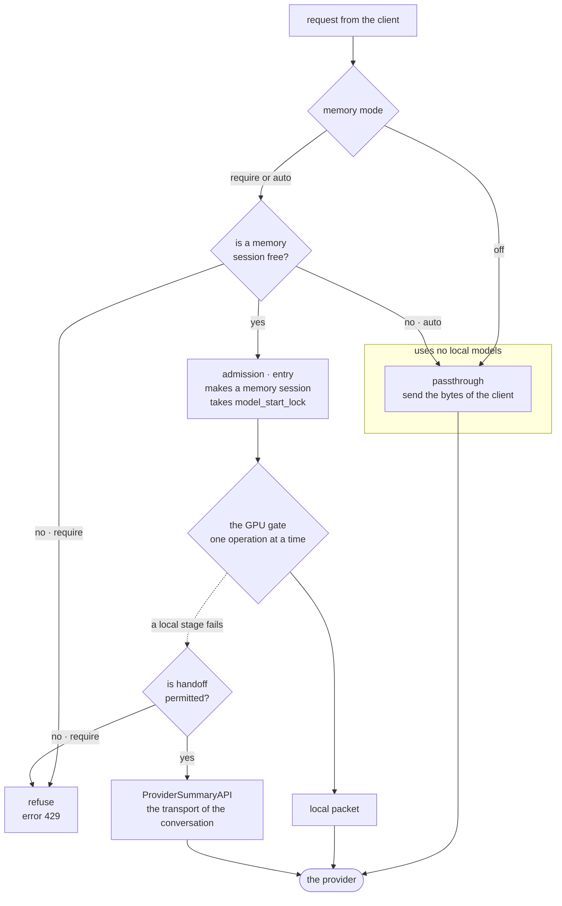
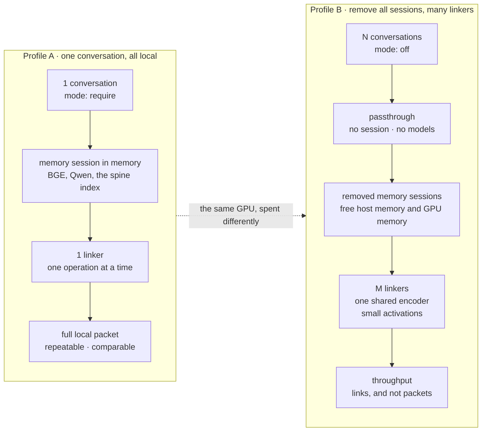
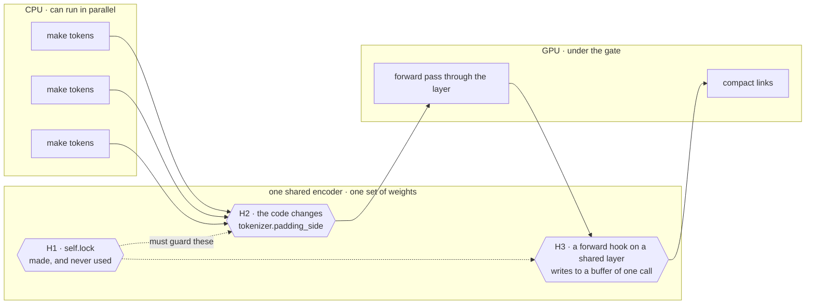

# Local model handoff and concurrent linking

**Status**: Design note
**Date**: 2026-10-20
**Applies to**: `runtime/local.py`, `runtime/model_lock.py`, `runtime/sessions.py`,
`associations/qwen_memory_linker.py`, `modeling/qwen_prefix.py`,
`interfaces/summary_api.py`, and the augment path in `interfaces/proxy_memory.py`
**Depends on**: `06 - Roadmaps/06 - Proxy Consolidation.md`, milestone M6
**Language**: ASD-STE100 writing rules. See *About the language*.

## About the language

This note follows the ASD-STE100 writing rules. Each sentence has 20 words or fewer.
Each paragraph has 6 sentences or fewer. The voice is active. The tense is simple
present.

Each sentence gives one idea. There are no metaphors and no idioms.

One word has one meaning. The *Terms* table gives each term. The note uses only
those terms for those things.

This note does not confirm the ASD-STE100 approved word list. That check needs the
specification itself, which this repository does not hold. A later pass can do it.

## Terms

| Term | Meaning in this note |
| --- | --- |
| **the proxy** | the server in `interfaces/proxy_server.py` |
| **a conversation** | one dialogue between a user and a model |
| **a memory session** | the server object that holds the memory of one conversation |
| **the local models** | the models that run on this machine |
| **the GPU gate** | the lock `gpu_gate` in `runtime/local.py` |
| **the encoder** | one `Qwen3PrefixEncoder` object |
| **the linker** | one `QwenMemoryLinker` object |
| **passthrough** | the proxy sends the bytes of the client and changes nothing |
| **handoff** | the proxy gives work to the provider API, because the local models cannot do it |
| **a packet** | the memory evidence that the proxy adds to a request |
| **saturated** | the GPU gate holds queued work in `_foreground` or `_background` |

## Purpose

The proxy does memory work on one GPU. The GPU does one operation at a time. This
limit controls how many conversations can have memory.

The proxy shows this limit as an error. The ninth conversation gets a message to
restart the proxy. A conversation also waits for the model work of other
conversations. Nobody selected these two results. They are effects of one lock.

This note corrects two things. First, the proxy must use the provider API when the
local models cannot serve a conversation. Second, the linker must do the work of
more than one conversation at the same time.

## The rule

**The proxy serves each conversation at the best level that is available. The proxy
never refuses a request because a model is busy. The receipt records the level.**

Local is the first level. Handoff is the second level. Passthrough is the last
level.

## The limits of the local models

We measured these values.

- **One GPU gate for each service.** `LocalRuntime.gpu_gate` is a
  `RecallPriorityLock` (`runtime/local.py:665`). This lock is reentrant. It has FIFO
  queues, and it gives priority to foreground work (`runtime/model_lock.py:16-40`).
  Each LLM call takes this lock (`runtime/local.py:753`). `CompressedAttention` uses
  the same lock (`:690`). Therefore one model operation runs at a time in the whole
  service.
- **One runtime for each service, and not for each conversation.**
  `NativeProxySessions` makes one `LocalRuntime` (`runtime/sessions.py:44`). Each
  memory session uses that same runtime. The comment at `:45-47` says that
  `model_start_lock` stays locked for minutes during a cold start.
- **Admission starts the model work.** The proxy makes the models of a memory
  session inside `MemoryProxy.entry()`. The order is `entry()`, then `factory()`,
  then `Backend._open` under `model_start_lock` (`runtime/sessions.py:145-146`). A
  request that returns before `entry()` uses no models.
- **The linker runs on the serving path.** Three modules import
  `QwenMemoryLinker`: `application/retrieval_workflow.py:24`,
  `search/section_attention.py:9`, and `search/context_card_retrieval.py:15`.
  Therefore each conversation does its own Qwen inspection under the GPU gate.
- **`max_sessions` refuses, and it does not queue.** `MemoryProxy.entry()` raises
  error 429 (`interfaces/proxy_memory.py:130`). The proxy removes no memory session
  to make space.

The true limit is one GPU behind one lock. The value `max_sessions` is only an
approximate measure of that limit.

## The three service levels

| Level | Cost | Conversations at the same time | Use |
| --- | --- | --- | --- |
| **Local** | GPU time under the GPU gate | one operation at a time | the default |
| **Handoff** | provider tokens, and more delay | no limit | the GPU gate is busy, or a local stage fails |
| **Passthrough** | none | no limit | the user wants no memory, or memory is not available |

The dotted box shows the important effect. Passthrough returns before `entry()`.
Therefore passthrough makes no memory session. It takes no `model_start_lock`. It
uses no models.

The GPU becomes free for other work. This is an effect of that one path, and it
is not a separate function.

Milestone M6 gives three modes. In mode `require`, the proxy must not use
passthrough. In mode `auto`, the proxy uses passthrough when memory is not
available. In mode `off`, the proxy always uses passthrough.

## The handoff

The rule has one condition and two targets.

**Start a handoff only when the local models are saturated. Send the work to the
active model, or to a designated secondary model.**

- **The condition is saturation, and nothing else.** Saturation means that the GPU
  gate has queued work. `RecallPriorityLock` holds a `_foreground` deque and a
  `_background` deque (`runtime/model_lock.py:20`). The depth of those queues is the
  measurement. A threshold on that depth is the trigger.
- **Target 1 is the active model.** This is the model that the conversation already
  uses. The proxy has it in `payload['model']`, and it has the transport of the
  client.
- **Target 2 is a designated secondary model.** An operator configures this model.
  Use it when the active model is not correct for memory work, or when it is too
  expensive.

### Why one condition is better than many

Saturation is a measurement. A failure is not a measurement.

The condition "a local stage failed" has no limit and no threshold. Therefore it
cannot be a policy.

This rule also gives each condition one response. Load gives less expensive memory.
A fault gives no memory, and the proxy reports the fault. Milestone M6 holds the
second rule.

### Target 1 exists already

`interfaces/summary_api.py` holds this mechanism. `ProviderSummaryAPI` takes the
provider, the model, and the `send` function of the conversation. Therefore target 1
needs no new transport and no new credential path.

Keep these two properties for target 2.

1. **Use the transport of the conversation for target 1.** The `send` function is
   the upstream function of the proxy. The body must agree with the format of the
   request (`summary_api.py:13-15`).
2. **Put the provider and the model in the receipt identity, and put nothing else
   there** (`summary_api.py:21-23`). An artifact from a model and an artifact from a
   local model must never have the same receipt. This rule protects measurements. A
   benchmark that used an API in secret measures that API.

### What this rule changes today

The flag `--memory-summary-api-fallback` escalates a summary when the **local summary
fails** (`runtime/sessions.py:81-83`). The new condition is saturation. These two
conditions are not the same.

Select one of these two options.

- **Strict.** Saturation is the only condition. A failed local summary then gives no
  memory for that turn, under M6. This option is simpler, and each condition has one
  response.
- **Both conditions.** Saturation and failure both start a handoff. This option keeps
  the behavior of today, and it adds the new condition.

This note recommends the strict option. The strict option changes the behavior of
the summary path, so an operator must agree to it first.

### A stage with no target

A handoff needs a form of the task that a model API can do. A summary has this form,
because the task is text in and text out.

The linker does not have this form. The linker reads the QK and OV circuits of the
model. No model API supplies this data.

Therefore the linker has no handoff target, and this is not a problem to correct.
Saturated linker work waits in the queue, or the turn uses passthrough under M6.

## The two profiles

The three levels are a range. These two profiles are the two points on that range
that we use. The profiles spend the local model budget on different things. They do
not only permit different amounts of concurrent work.

### Profile A — one conversation, all local

Profile A gives memory to one conversation. All work is local. The proxy sends
nothing to the API. We built the system in this profile, and we measured it in this
profile.

- Set `--memory-max-sessions 1`. The proxy removes no session, because there is only
  one session.
- Use memory mode `require`. The proxy must not use passthrough, and it must not use
  a handoff. A request gets the full local packet, or the request fails and reports
  the failure.
- Set `--no-memory-summary-api-fallback`. Only local models make summaries.
  Therefore the result is local, and it is repeatable against the pinned weights.
- Use one linker on one encoder, one operation at a time. This is the behavior
  today, and this note does not change it.

Use Profile A for one interactive conversation. Also use Profile A for **each
measurement**. Numbers from Profile B do not compare with numbers from Profile A.
The receipt must record the profile.

### Profile B — remove all sessions, many linkers

Profile B gives the full local budget to the linker. Live traffic uses passthrough.
Passthrough is the reason that the GPU becomes free for the linker.

- Use memory mode `off` for live traffic. A passthrough request returns before
  `entry()`. Therefore it makes no memory session, and it uses no models.
- Remove each memory session. Use the mechanism of `MemoryProxy.swap`:
  `SessionEntry.stale`, then `session.close()`, then `factory.forget()`. This frees
  host memory and the index of each session.
- Run as many linkers as the activation memory permits.

**A copy of the linker is small.** `QwenMemoryLinker.__init__` takes an
`encoder: Qwen3PrefixEncoder` (`associations/qwen_memory_linker.py:155-157`).
Therefore a linker borrows the weights, and it does not hold them. One copy costs a
few integers and one reference. The docstring says that the candidate text and the
activations exist for one forward pass only (`:148-152`). No K and V cache becomes
larger. The limits are `max_candidates=8` and `max_workspace_tokens=1024`.

Therefore many linkers share one set of weights. They cost only small activations.
There is no copy of the weights, and there is no out-of-memory error.

**This replaces the earlier plan.** That plan put the work of many conversations
into one forward pass. With one shared encoder and small activations, concurrent work
gives most of the benefit. Concurrent work also needs no code to group the work. A
group of forward passes stays as a later improvement to throughput. It is not the
change that makes Profile B possible.

**The tokenizer runs on the CPU.** The encoder holds one `AutoTokenizer`
(`modeling/qwen_prefix.py:564`). The embedding operation runs on the CPU, and then
the data moves to the device (`:572`). The tokenizer needs no GPU, and it needs no
lock.

Therefore Profile B is a pipeline. Many CPU cores make tokens. The GPU then does
small forward passes. Profile B is not only many linkers that wait for one lock.

## The encoder is not safe for concurrent use

Profile B must not simply stop the serialization. The GPU gate hides three problems.
If you remove the gate, these problems give **wrong results and no error message**.

1. **H1. The lock exists, and no code uses it.** `Qwen3PrefixEncoder` makes
   `self.lock` at `modeling/qwen_prefix.py:76`. No other line in that file uses it.
   Therefore the encoder has no internal serialization. It depends only on the
   external gate.
2. **H2. `encode_layers` changes shared tokenizer data.** The code sets
   `self.tokenizer.padding_side` to `right`, and then it restores the old value
   (`:788-789`). Two concurrent calls compete for this field. The second call makes
   tokens with the wrong padding. This corrupts `readout_indices` and the pooled
   residual, and it raises no error.
3. **H3. The code adds a forward hook to a shared layer.** The call is
   `self.model.layers[layer].register_forward_hook(save_layer)` (`:786`). The hook
   writes into a buffer of one call. The hook runs for each concurrent forward pass
   through that layer. Therefore two concurrent calls corrupt the activations of each
   other.

Problem H1 needs a lock. Problem H2 needs one argument. **Problem H3 is the true
blocker.** The design of this hook is incorrect for concurrent calls. A better lock
does not correct H3.

### How to do Profile B in steps

Do the least expensive step first.

- **Step B0. Make only the CPU stage concurrent.** Make tokens with more than one
  worker. Give each worker its own tokenizer, or put one lock around the call to the
  tokenizer. Keep each forward pass under the existing gate. This step gets the CPU
  benefit. It does not touch H2 or H3.

  **Measure first.** Find how much of one linker pass makes tokens. If that part is
  small, then step B0 is the full task. Then do not do step B1 and do not do step B2.

- **Step B1. Make the forward pass safe for concurrent calls.** Replace the shared
  hook with a capture that belongs to one pass. Do not change `padding_side` on the
  shared tokenizer. Use `self.lock`, or delete it. After this step, the gate can
  admit concurrent linker passes.

- **Step B2. Admit N concurrent passes.** Change `RecallPriorityLock` to use the
  activation memory as the limit. Do not use a count of one. Keep the foreground
  priority. An interactive request must still pass a background batch.

**A differential test controls step B1 and step B2.** Both steps change
`associations/qwen_memory_linker.py` or `modeling/qwen_prefix.py`. The attention
cache identity includes the bytes of both files (`runtime/attention.py:12`).
Therefore the cache becomes invalid on each host when you change one of these files.
A concurrency error can also make links that look correct. The cache then holds
those wrong links.

Prove that the links are identical to the links from the serial path. Do this
before you merge one of these steps.

## Why the design has this shape

- **Never refuse because a model is busy.** A memory system that fails the request
  of a user is worse than a memory system with no memory. Milestone M6 has the same
  property at a higher level. There the reduced level is no memory. Here the reduced
  level is less expensive memory.
- **Record the level.** An invisible reduction becomes a problem later. Two examples
  are a benchmark that gets worse, and a conversation that forgets. Use the receipt
  rule of `ProviderSummaryAPI`.
- **Group the forward passes, and do not change only the lock.** Contention is the
  symptom. The repeated forward pass over similar prefixes is the cost. If you
  change only the lock, then you change only the order of the queue.
- **Keep one runtime.** This note does not add a second `LocalRuntime`. It does not
  add a second GPU context. Model memory is the limit. A copy of that memory
  exchanges a queue for an out-of-memory error.

## Open questions

- **Who selects the level?** The runtime knows that the gate is busy. The retrieval
  policy knows if a reduced packet is useful. The control plane knows the mode of the
  operator. One component must select the level. The policy is the correct component,
  and a signal from the runtime informs it.
- **Does the proxy hand off one stage, or one turn?** A handoff of one stage makes a
  packet from two sources. This is acceptable for a summary. This is not acceptable
  for a stage that supplies a content-addressed identity.
- **How does the operator control the cost?** A handoff spends the provider tokens of
  the user on background work. The user did not ask for that work. The flag
  `--memory-summary-api-fallback` is on by default. This default is acceptable for a
  failed summary. It is not acceptable for routine load reduction. Add a budget, or
  add a counter in the `serving` block of the status document.
- **Does a group of forward passes change the result?** A group must give the same
  numbers. Attention over one shared forward pass is the place where this can fail.
  Write a differential test against the serial path first.

## Work packages

| Package | Owns | Builds against |
| --- | --- | --- |
| **A — capacity signal** | `MemoryProxy.status()`, `memory_health`, the status schema | publish `max_sessions` next to `active_sessions`; add a health reason for full capacity |
| **B — levels and receipts** | a service level on the recall receipt; one counter for each level in `serving` | the receipt rule of `ProviderSummaryAPI` |
| **C — concurrent linker** | `associations/qwen_memory_linker.py`, `modeling/qwen_prefix.py`, a differential test | steps B0, B1, and B2; the cache identity becomes invalid |
| **D — reduced retrieval path** | the fallback of the retrieval policy that uses the API | the open question above; the policy must agree first |

Package A and package B come first. Without the capacity signal and the level in the
receipt, nobody can measure package C or package D.
